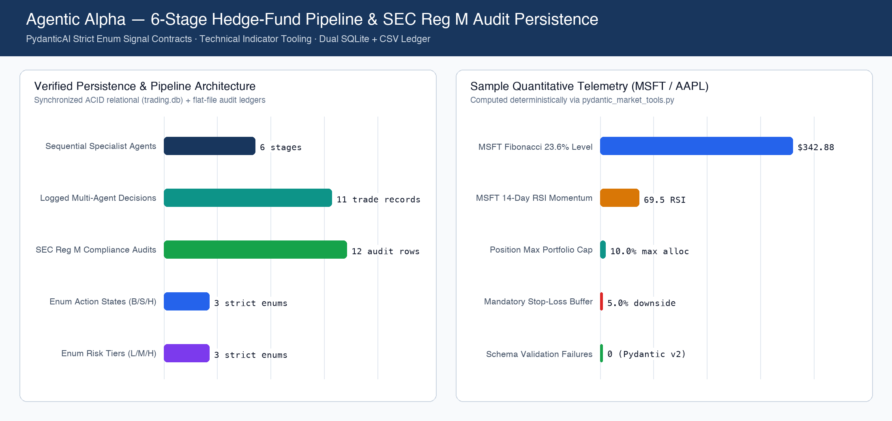
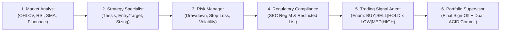

<div align="center">
  
  <br/><br/>
  <p>
    
    
    
    
    <a href="LICENSE"></a>
  </p>
</div>

---

Six-agent quantitative equity research, risk governance, and trade-signal platform built with **PydanticAI**, **OpenAI (`gpt-4o`)**, **Streamlit**, and **Plotly**—enforcing deterministic analyst-to-supervisor execution, Fibonacci & RSI market tools, **SEC Regulation M** pre-trade compliance gating, strict enum-typed `TradingSignal` contracts, and dual ACID **SQLite / PostgreSQL + CSV** persistence.



---

## 1. Six-Stage Sequential Institutional Workflow



---

## 2. Verified Multi-Agent Ledger & Compliance Trail (`data_storage/`)

### Sample Persisted Trading Decisions ([`data_storage/trading_decisions.csv`](data_storage/trading_decisions.csv))
```csv
id,symbol,decision,confidence,agent_name,created_at
1,MSFT,BUY,0.92,strategy_agent,2026-10-19T19:14:45.602630
2,AAPL,HOLD,0.75,trading_signal_agent,2026-10-19T19:20:44.384845
3,AAPL,HOLD,0.75,trading_signal_agent,2026-10-19T19:21:43.864840
4,AAPL,HOLD,0.68,trading_signal_agent,2026-10-19T19:23:14.247128
5,AAPL,SIGNAL:HOLD | Risk:MEDIUM,0.68,trading_signal_agent,2026-10-19T19:23:16.315314
```

### Sample SEC Regulation M Audit Records ([`data_storage/audit_trail.csv`](data_storage/audit_trail.csv))
```csv
id,symbol,timestamp,decision_type,action,confidence,rationale,compliance_status,risk_level,position_size,blocked_trades
1,MSFT,2026-10-19T19:14:45.610736,STRATEGY,BUY,0.92,Testing audit storage,COMPLIANT,LOW,,
2,AAPL,2026-10-19T19:20:46.693117,TRADING_SIGNAL,"HOLD decision based on current market data, Fibonacci levels near 23.6%, and historical BUY signals with high confidence",0.75,"AAPL is experiencing a sideways trend with RSI near overbought territory at 69.23. Fibonacci analysis suggests price around 23.6% retracement level, indicating short-term resistance. Historical patterns show a single high-confidence BUY decision recently. Technicals suggest a conservative HOLD decision.",,MEDIUM,,
3,AAPL,2026-10-19T19:21:46.417966,TRADING_SIGNAL,HOLD,0.75,"The technical analysis indicates that AAPL is trading sideways with an RSI of 69.34, suggesting it's close to overbought but not there yet. The stock's current price (341.83) is near the 23.6% Fibonacci retracement level ($342.88), indicating limited upward momentum. Historical patterns show a mixed signal, with equal past decisions to HOLD and BUY, averaging a high confidence level. Risks are deemed MEDIUM due to market's stable volume and price stability between key Fibonacci levels.",,MEDIUM,,
4,AAPL,2026-10-19T19:21:57.068050,RISK,"Assessed market data, sentiment, and historical patterns for AAPL, focusing on sideways trend and neutral sentiment.",0.75,"AAPL is currently exhibiting a sideways trend with neutral sentiment over the past week. Recent analysis shows that the majority of historical decisions have leaned towards holding, with a high average confidence. Technical indicators suggest a high RSI approaching overbought levels, though volume remains normal.",,MEDIUM,,
5,AAPL,2026-10-19T19:22:16.994088,RISK,HOLD,0.8,Market data suggests AAPL is trading sideways with a high RSI indicating potential overbought conditions. Sentiment is neutral with normal volume and marginal price changes. Historical decisions show a preference for HOLD with high confidence. Current volatility is low.,,MEDIUM,,
```

---

## 3. Quick Start

```bash
python3 -m venv .venv
source .venv/bin/activate
pip install -r requirements.txt
cp .env.example .env

# Launch interactive Streamlit trading & compliance workstation
streamlit run app/main.py --server.port 5000
```

## License

MIT License — see [LICENSE](LICENSE).
